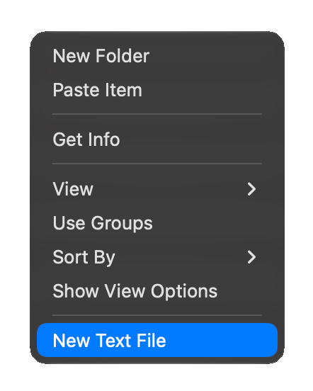

# New Text File for Finder

Adds **New Text File** to the right-click menu on empty space in any Finder folder on macOS, right beside *New Folder*.



## What it does

- Adds a **New Text File** item to Finder's right-click menu on empty space
- Creates `untitled.txt` in that folder, or `untitled 2.txt`, `untitled 3.txt` and so on if the name is taken
- Selects the new file so you can press **Return** to rename it

## Requirements

- macOS 12 or later
- Apple's command line tools (the installer prompts for them if they are missing)

## Install

1. Download `Install-Right-Click-New-File.command`.
2. Open Terminal, type `bash ` (with a trailing space), drag the downloaded file onto the window, and press Return. Or run:

   ```bash
   bash ~/Downloads/Install-Right-Click-New-File.command
   ```

3. If Terminal says the Swift compiler is not found, click **Install** in the popup, wait for it to finish, then run the command again.
4. When System Settings opens, go to **General → Login Items & Extensions → Extensions** (or search "Finder extensions") and tick **New Text File**.
5. Right-click empty space in any Finder folder and choose **New Text File**.

## Troubleshooting

If the menu item does not appear:

- Check the tick box in System Settings
- Restart Finder: `killall Finder`
- Log out and back in, or run the installer again

## Uninstall

```bash
pluginkit -r ~/Applications/NewTextFile.app/Contents/PlugIns/NewTextFileExt.appex
rm -rf ~/Applications/NewTextFile.app
killall Finder
```

Nothing else is installed on your Mac.

## Customise

To create `.md` or another file type, edit `untitled.txt` and `untitled \(n).txt` in the Swift source inside the installer script, then run the installer again.

## How it works

The installer compiles a small [Finder Sync extension](https://developer.apple.com/documentation/findersync) with `swiftc`, wraps it in a minimal host app at `~/Applications/NewTextFile.app`, signs it ad hoc for local use, and registers it with `pluginkit`. The extension watches `/` so the menu item appears in every folder, and creates the file in the folder you right-clicked.

## Notes

- The extension is signed for use on your own Mac only. On another Mac, run the installer there.
- The extension is sandboxed with a temporary exception that allows writing to any path, which is needed to create files in arbitrary folders. It is not suitable for the Mac App Store.

## Files

| File | Purpose |
|------|---------|
| `Install-Right-Click-New-File.command` | Builds and installs the extension |
| `instructions.txt` | Plain-text install and uninstall guide |
| `new-text-file.html` | Standalone help page |
| `example.png` | Screenshot used in this README |

## Author

[Pixelagent](https://pixelagent.co.uk)
